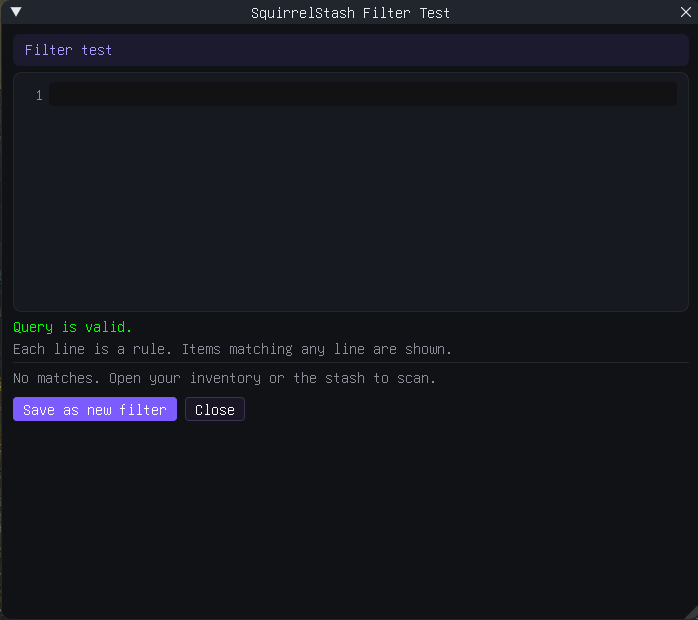
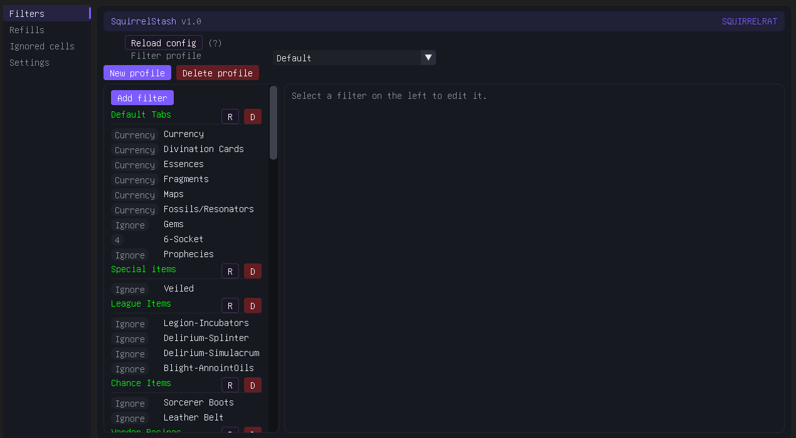
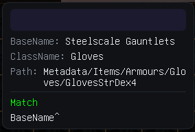
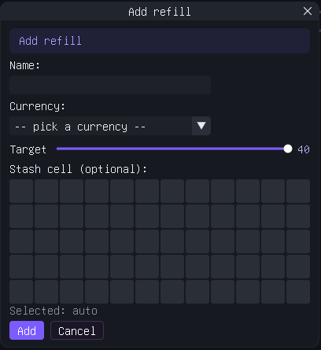

# SquirrelStash

Automatic stash sorting for ExileCore: drop rules, filter profiles and currency refills.

Version v1.0. See `CHANGELOG.md`.

## Features

### Filter editor

In-game editing with syntax highlighting, autocomplete and inline errors.

### Filter test workbench

Run a query against your inventory and stash, see what matches, then save
it as a filter.



### Filter profiles

Keep several named filter sets and switch between them, with affix-aware
comparison and more keywords.



### Hover check

Hover over an item to see whether the active filter would stash it.



### Currency refills

Top up portal scrolls, wisdom scrolls and other currency from a source tab.



## Usage

Open your stash and press the stash hotkey. Manage filters and profiles in
the plugin settings. Use the test workbench to check a query before saving.

## Wickerman Viscera slots

All Viscera share the item class `Viscera`, so `ClassName=Viscera` catches all
166 of them. Item names do not identify the slot. `Justicar's Helm` and `Coven
Queen's Crown` are both head pieces, `Golemic Stone` and `Aristocrat's Torso`
are body pieces, and `Coagulated Essence` is a leg piece.

Use `VisceraSlot` instead. It reads the game's own `viscera_arm`,
`viscera_head`, `viscera_leg` and `viscera_body` tags on each base type:

```
Viscera Head:VisceraSlot=head:Viscera
Viscera Arm:VisceraSlot=arm:Viscera
Viscera Leg:VisceraSlot=leg:Viscera
Viscera Body:VisceraSlot=body:Viscera
```

These four filters ship with the default profile. New filters start as
Ignore, so open the Filters tab and pick a destination stash tab for each
one. The third field is only a UI grouping label. Full list:
`docs/viscera-slots.md`.

Wombgifts need no special property. There are five and their names are
consistent, so the default profile has one `BaseName=... Wombgift` filter per
type. Growing Wombgift is class `RemovedItem`, not `BrequelFruit`, so the old
`ClassName^BrequelFruit` catch-all misses it. Details: `docs/wombgifts.md`.
